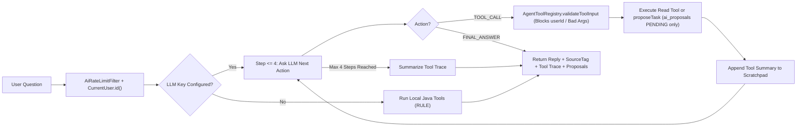

# PathPilot AI Layer Architecture (`docs/ai.md`)

PathPilot adds a strictly grounded, privacy-preserving AI career assistant on top of your saved tracker records. **AI is always optional and proposal-only**: when no API key is configured or quota is reached, PathPilot falls back seamlessly to deterministic Java rules (`RULE`).

---

## 1. Chosen Provider & Swappable `LlmClient`

- **Default Provider**: **Google Gemini API** (`ai.google.dev`) using **`gemini-3.5-flash-lite`** via `GeminiLlmClient`.
- **Why Gemini**: Supports native `responseMimeType: "application/json"` with strict `responseSchema` enforcement, low-latency free tier for development, and server-side API key (`x-goog-api-key` header).
- **Swapping Providers**: Business services (`DailyRecommendationService`, `JdAnalysisService`, `MonthlySummaryService`, `AgentService`) depend **only** on `LlmClient`:
  ```java
  public interface LlmClient {
      boolean isConfigured();
      LlmResult generate(LlmPrompt prompt, JsonSchema schema);
  }
  ```
  To swap to OpenAI, Anthropic, or a local Ollama server, implement `LlmClient` in `com.pathpilot.ai` and register that bean instead of `GeminiLlmClient` without touching any feature service or controller.

---

## 2. Privacy, Security & Guardrails

1. **Server-Side Keys Only**: `LLM_API_KEY` is read strictly from server environment variables (`AppProperties.AiProperties`). Never exposed to React or Git.
2. **Minimum Non-PII Context**: Prompts never include user emails, phone numbers, GitHub PATs, raw personal diary notes, or recruiter emails — only counts, skill chips/levels, project titles/stacks, sanitized JD text, and snapshot metrics.
3. **Structured JSON + Retry + Rule Fallback (`AiStructuredExecutor`)**:
   - Requests structured JSON matching a schema.
   - Runs domain grounding validation (e.g. `matchedSkills` must exist in Settings profile; `weakAreas` must be marked `Beginner`; `recommendedProjectsToShow` must belong to the user; `MonthlySummaryGrounder` verifies every numeric token appears in the saved monthly snapshot).
   - If validation or JSON parsing fails, retries **once** with the validation error, then falls back cleanly to the deterministic Java rule engine (`SourceTag = "RULE"`).
4. **Resilience, Caching & Rate Limiting**:
   - Timeouts (`LLM_TIMEOUT_MS`), exponential backoff retries on HTTP 429/5xx, and friendly fallback notices (`notice`) on quota exhaustion.
   - `AiCacheService` caches daily recommendations and monthly summaries per user per period (`?refresh=true` bypasses cache).
   - `AiRateLimitFilter` enforces a sliding-window rate limit per authenticated user on `/api/ai/**` (excluding proposal inbox reads/approvals).
5. **Proposal-Only Changes (`ai_proposals`)**:
   - AI **never** directly inserts/edits `tasks`, `goals`, or `job_applications`.
   - Every task suggestion enters `ai_proposals` (`PENDING`). Only clicking **Approve** in the Approval Inbox writes a real `Task`, updates `daily_logs`, and records `record_history` (`data_source = "AI"`).

---

## 3. Agent Tool-Calling Loop (Simple English)

When you ask PathPilot AI Assistant a question (`POST /api/ai/agent`):

1. **You ask a question** in plain English (for example, *"What are my overdue tasks and what should I focus on today?"*).
2. **The server loads your identity** securely from your login cookie (`CurrentUser.id()`). The AI model is **never allowed** to choose or pass a `userId`.
3. **Step-by-step tool loop (maximum 4 steps)**:
   - The server sends your question plus a menu of **5 safe tools** (`getRecordedActivity`, `calculateProgress`, `findOverdueTasks`, `analyzeJobDescription`, `proposeTask`) to Gemini.
   - Gemini picks either **"call one tool with specific arguments"** or **"here is my final answer"**.
   - Before running any tool, `AgentToolRegistry` checks the arguments: if the model tries an unknown tool, invalid date/range, or tries to sneak in `userId`, the server blocks it immediately.
   - The server runs the Java tool against **your records only**, adds the tool summary to a scratchpad, and asks Gemini for the next step.
   - If the assistant decides to suggest a task via `proposeTask`, it creates a **`PENDING` row in `ai_proposals`** (never a real task) so you stay in control via the Approval Inbox.
4. **Guaranteed termination**: After at most **4 tool calls** (or immediately if no API key is configured), the server returns a grounded summary with a trace of every tool checked (`SourceTag` `"AI"` or `"RULE"` + *"AI-generated. Based on your saved records."*).



---

## 4. Test Strategy (Zero Real API Spend)

All unit and integration tests mock `LlmClient`:
- `RuleRecommendationEngineTest` — coding inactivity gap, overdue tasks, follow-ups, goal gaps, empty/done days.
- `JdAnalysisServiceTest` — profile skill & project grounding enforcement, retry on hallucinated match, quota fallback, cross-user 404.
- `MonthlySummaryGrounderTest` — rejects invented numbers, allows snapshot numbers, verifies per-user caching.
- `AgentServiceTest` — rejects `userId` in tool args (`403 FORBIDDEN`), rejects invalid tools, caps loop at 4 calls, `proposeTask` never saves real tasks.
- `AiIntegrationTest` — end-to-end MockMvc tests for recommendations, proposal approval flow, JD analysis, monthly summary, and `429 AI_RATE_LIMIT_EXCEEDED`.
