# PathPilot — Database Entity Relationship Diagram (ERD)

> All timestamps are stored in **UTC** (`DATETIME(6)`), and each user's local time zone is stored in `user_profiles.time_zone`.  
> Every table except `users` contains a `user_id` foreign key referencing `users(id)` so all queries remain strictly isolated per user.

---

## Mermaid ERD

```mermaid
erDiagram
    users ||--|| user_profiles : "has profile"
    users ||--o{ tasks : "owns"
    users ||--o{ goals : "sets"
    users ||--o{ daily_logs : "records"
    users ||--o{ learning_records : "logs"
    users ||--o{ coding_activities : "logs"
    users ||--o{ github_events : "imports"
    users ||--o{ projects : "builds"
    users ||--o{ project_milestones : "owns"
    users ||--o{ project_worklogs : "owns"
    users ||--o{ job_applications : "tracks"
    users ||--o{ job_status_history : "owns"
    users ||--o{ connected_accounts : "links"
    users ||--o{ monthly_reports : "generates"
    users ||--o{ ai_proposals : "reviews"
    users ||--|| notification_preferences : "configures"
    users ||--o{ record_history : "audits"

    goals ||--o{ tasks : "groups (optional)"
    projects ||--o{ project_milestones : "has"
    projects ||--o{ project_worklogs : "has"
    job_applications ||--o{ job_status_history : "tracks changes"
    connected_accounts ||--o{ github_events : "source account (optional)"

    users {
        BIGINT id PK
        VARCHAR email UK
        VARCHAR password_hash
        VARCHAR role
        BOOLEAN is_active
        DATETIME created_at_utc
        DATETIME updated_at_utc
    }

    user_profiles {
        BIGINT id PK
        BIGINT user_id FK
        VARCHAR full_name
        VARCHAR target_role
        VARCHAR time_zone
        TEXT bio
        DATETIME created_at_utc
        DATETIME updated_at_utc
    }

    tasks {
        BIGINT id PK
        BIGINT user_id FK
        BIGINT goal_id FK
        VARCHAR title
        TEXT description
        DATE task_date
        VARCHAR status
        VARCHAR category
        VARCHAR data_source
        DATETIME created_at_utc
        DATETIME updated_at_utc
    }

    goals {
        BIGINT id PK
        BIGINT user_id FK
        VARCHAR title
        TEXT description
        VARCHAR period_type
        DATE start_date
        DATE target_date
        VARCHAR status
        VARCHAR data_source
        DATETIME created_at_utc
        DATETIME updated_at_utc
    }

    daily_logs {
        BIGINT id PK
        BIGINT user_id FK
        DATE log_date
        VARCHAR day_status
        TEXT reflection_note
        VARCHAR data_source
        DATETIME created_at_utc
        DATETIME updated_at_utc
    }

    learning_records {
        BIGINT id PK
        BIGINT user_id FK
        DATE record_date
        VARCHAR topic
        INT minutes_spent
        TEXT notes
        VARCHAR data_source
        DATETIME created_at_utc
        DATETIME updated_at_utc
    }

    coding_activities {
        BIGINT id PK
        BIGINT user_id FK
        DATE activity_date
        VARCHAR platform
        INT problems_solved
        INT minutes_spent
        VARCHAR problem_title
        VARCHAR reference_url
        TEXT notes
        VARCHAR data_source
        DATETIME created_at_utc
        DATETIME updated_at_utc
    }

    github_events {
        BIGINT id PK
        BIGINT user_id FK
        BIGINT connected_account_id FK
        VARCHAR external_event_id
        VARCHAR event_type
        VARCHAR repo_name
        DATE event_date
        DATETIME occurred_at_utc
        TEXT payload_summary
        VARCHAR data_source
        DATETIME created_at_utc
    }

    projects {
        BIGINT id PK
        BIGINT user_id FK
        VARCHAR title
        TEXT description
        VARCHAR tech_stack
        VARCHAR repo_url
        VARCHAR live_url
        VARCHAR status
        DATE start_date
        DATE target_date
        VARCHAR data_source
        DATETIME created_at_utc
        DATETIME updated_at_utc
    }

    project_milestones {
        BIGINT id PK
        BIGINT user_id FK
        BIGINT project_id FK
        VARCHAR title
        DATE due_date
        VARCHAR status
        INT sort_order
        VARCHAR data_source
        DATETIME created_at_utc
        DATETIME updated_at_utc
    }

    project_worklogs {
        BIGINT id PK
        BIGINT user_id FK
        BIGINT project_id FK
        DATE work_date
        INT minutes_spent
        TEXT summary
        VARCHAR data_source
        DATETIME created_at_utc
        DATETIME updated_at_utc
    }

    job_applications {
        BIGINT id PK
        BIGINT user_id FK
        VARCHAR company_name
        VARCHAR role_title
        VARCHAR status
        DATE applied_date
        VARCHAR job_url
        VARCHAR location
        TEXT notes
        VARCHAR data_source
        DATETIME created_at_utc
        DATETIME updated_at_utc
    }

    job_status_history {
        BIGINT id PK
        BIGINT user_id FK
        BIGINT job_application_id FK
        VARCHAR previous_status
        VARCHAR new_status
        DATE changed_date
        TEXT note
        DATETIME changed_at_utc
    }

    connected_accounts {
        BIGINT id PK
        BIGINT user_id FK
        VARCHAR provider
        VARCHAR username_or_handle
        VARCHAR profile_url
        BOOLEAN sync_enabled
        DATETIME last_synced_at_utc
        DATETIME created_at_utc
        DATETIME updated_at_utc
    }

    monthly_reports {
        BIGINT id PK
        BIGINT user_id FK
        CHAR report_month
        INT planned_tasks
        INT completed_tasks
        INT coding_days
        INT learning_days
        DECIMAL task_completion_rate
        DECIMAL coding_activity_rate
        TEXT summary_notes
        VARCHAR data_source
        DATETIME generated_at_utc
    }

    ai_proposals {
        BIGINT id PK
        BIGINT user_id FK
        VARCHAR target_entity
        VARCHAR proposal_type
        VARCHAR title
        JSON proposed_payload
        VARCHAR status
        VARCHAR data_source
        DATE proposal_date
        DATETIME created_at_utc
        DATETIME reviewed_at_utc
    }

    notification_preferences {
        BIGINT id PK
        BIGINT user_id FK
        BOOLEAN daily_reminder_enabled
        TIME daily_reminder_time
        BOOLEAN weekly_digest_enabled
        BOOLEAN monthly_report_ready_enabled
        DATETIME created_at_utc
        DATETIME updated_at_utc
    }

    record_history {
        BIGINT id PK
        BIGINT user_id FK
        VARCHAR entity_type
        BIGINT entity_id
        VARCHAR action_type
        VARCHAR actor_source
        DATE record_date
        TEXT change_summary
        DATETIME created_at_utc
    }
```

---

## One-Line Explanation of Every Table

| # | Table | Purpose |
|---|---|---|
| 1 | `users` | Stores registered user login accounts with unique email and BCrypt password hashes. |
| 2 | `user_profiles` | Stores each user's display name, target career role, and local time zone (`time_zone`). |
| 3 | `tasks` | Stores planned daily, weekly, or monthly tasks with status (`PENDING`, `COMPLETED`, `SKIPPED`) and source tag. |
| 4 | `goals` | Stores higher-level learning or career goals that tasks can optionally link to. |
| 5 | `daily_logs` | Stores explicit daily check-ins (such as confirmed `REST` days or reflections) so unlogged days remain `"unrecorded"`. |
| 6 | `learning_records` | Stores dated study/learning sessions used to count recorded monthly learning days. |
| 7 | `coding_activities` | Stores manual coding practice logs (platform, problems solved, time spent, and reference link). |
| 8 | `github_events` | Stores official GitHub activity imported via API (`IMPORTED`) for a user's connected GitHub account. |
| 9 | `projects` | Stores portfolio/personal projects with tech stack, links, and status. |
| 10 | `project_milestones` | Stores planned and completed milestones per project for `ProgressCalculator` progress percentages. |
| 11 | `project_worklogs` | Stores dated work entries and minutes invested in each project. |
| 12 | `job_applications` | Stores job applications with company, role, current status, and applied date. |
| 13 | `job_status_history` | Stores every status change on a job application over time. |
| 14 | `connected_accounts` | Stores external platform handles/profile URLs (GitHub, LeetCode, CodingBat, etc.) without storing raw secrets in frontend. |
| 15 | `monthly_reports` | Stores generated `yyyy-MM` report snapshots calculated from saved records (`CALCULATED`). |
| 16 | `ai_proposals` | Stores AI-suggested plans or edits (`PENDING`, `APPROVED`, `REJECTED`) so AI never modifies records without approval. |
| 17 | `notification_preferences` | Stores each user's reminder and report notification settings. |
| 18 | `record_history` | Stores an audit log of creations, edits, and approved AI changes per user. |
